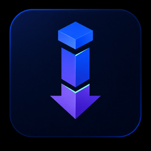
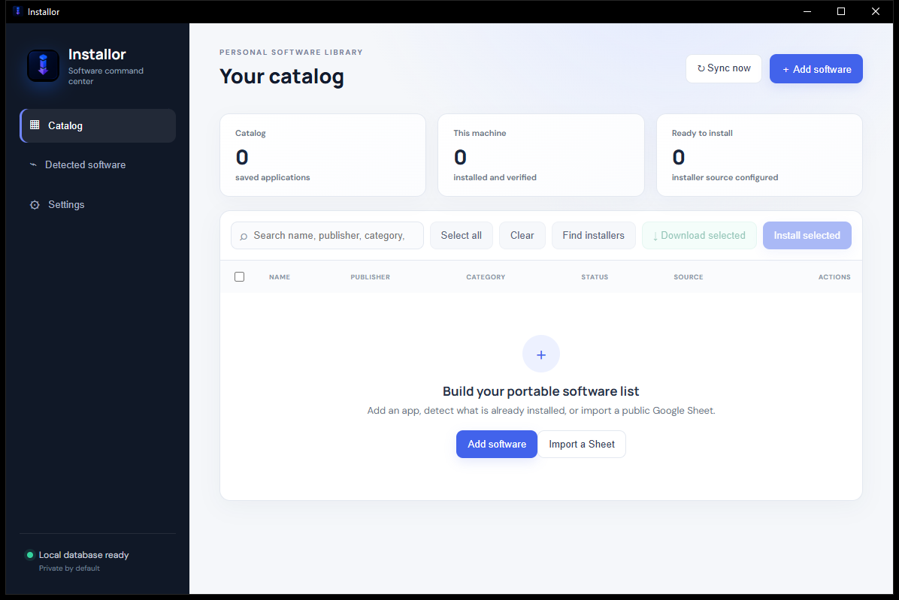

<p align="center">
  
</p>

<h1 align="center">Installor</h1>

<p align="center"><strong>Your software catalog, detection, acquisition, and installation workflow—portable across machines.</strong></p>

<p align="center">
  <a href="https://github.com/the-sudipta/installor/actions/workflows/ci.yml"></a>
  <a href="https://github.com/the-sudipta/installor/releases/latest"></a>
  <a href="LICENSE"></a>
  <a href="https://the-sudipta.github.io/installor/"></a>
</p>

<p align="center">
  
  
  
  
  
  
</p>

<p align="center">
  <a href="https://github.com/the-sudipta/installor/releases/latest"><strong>Download</strong></a> ·
  <a href="https://the-sudipta.github.io/installor/"><strong>Website</strong></a> ·
  <a href="docs/USER_GUIDE.md"><strong>User guide</strong></a> ·
  <a href="docs/ARCHITECTURE.md"><strong>Architecture</strong></a> ·
  <a href="docs/INDUSTRIAL_PHD_PROSPECTUS.md"><strong>Research prospectus</strong></a>
</p>



Installor is a local-first desktop application for people who repeatedly configure computers and want one trustworthy place to record, detect, download, verify, and install software. A catalog can be maintained locally, imported from a publicly shared Google Sheet owned by **any Google account**, or synchronized through an optional self-deployed Apps Script bridge.

No Google Cloud project, OAuth client, API key, or account connection is required for public-link imports.

## Why Installor

<table width="100%">
  <tr>
    <td width="33%" valign="top"><strong>Portable catalog</strong><br />Keep software names, sources, platform targets, installer types, checksums, tags, and notes in one structured library.</td>
    <td width="33%" valign="top"><strong>Human-controlled automation</strong><br />Detection and file matching produce reviewable suggestions. Installation begins only after an explicit selection and confirmation.</td>
    <td width="34%" valign="top"><strong>Account-independent sharing</strong><br />Import a correctly structured public Google Sheet regardless of who owns it, without connecting the owner's Google account.</td>
  </tr>
  <tr>
    <td valign="top"><strong>Native acquisition</strong><br />Use winget, Homebrew, APT, DNF, Pacman, Flatpak, or a direct installer URL.</td>
    <td valign="top"><strong>Integrity-aware downloads</strong><br />Stream files with progress and validate SHA-256 checksums when supplied.</td>
    <td valign="top"><strong>Local-first privacy</strong><br />Catalog state stays in a per-user SQLite database; bridge secrets use the operating-system credential vault.</td>
  </tr>
</table>

## Install and start

### Windows—the verified v0.1.1 path

1. Open the [latest release](https://github.com/the-sudipta/installor/releases/latest).
2. Download `Installor_0.1.1_x64-setup.exe` for the guided installer, or the `.msi` package for managed deployment.
3. Run the installer and open **Installor** from the Start menu.
4. An unsigned community build may trigger Microsoft SmartScreen. Review the publisher and release checksum before choosing to continue.

The standalone `installor.exe` is also attached to the release for portable evaluation. It does not provide Start-menu integration or an uninstaller.

### macOS and Linux

The codebase, detector implementations, installer plans, platform icons, and GitHub build matrix support macOS and Linux. Native packages are produced by the tagged-release workflow. Because v0.1.1 was manually exercised on Windows, treat other platform packages as evaluation builds until the corresponding checks in [the manual QA matrix](docs/USER_GUIDE.md#platform-status-and-limitations) are completed.

<table width="100%">
  <tr><th width="22%" align="left">Platform</th><th width="28%" align="left">Detection</th><th width="30%" align="left">Installation routes</th><th width="20%" align="left">v0.1.1 status</th></tr>
  <tr><td>Windows</td><td>Registry uninstall entries</td><td>winget, MSI, Inno Setup, NSIS, interactive installers</td><td><strong>Locally built and tested</strong></td></tr>
  <tr><td>macOS</td><td><code>system_profiler</code></td><td>Homebrew, PKG, DMG, interactive installers</td><td>CI/package configuration ready</td></tr>
  <tr><td>Linux</td><td>dpkg, rpm, pacman, Flatpak, Snap discovery</td><td>APT, DNF, Pacman, Flatpak, DEB, RPM, AppImage</td><td>CI/package configuration ready</td></tr>
</table>

## Use Installor

### 1. Build your catalog locally

Open **Catalog → Add software** and provide at least a name. For a package-manager entry, select the source and enter its package ID. For a custom installer, supply a trusted HTTPS download URL or place the installer in the configured download folder. Add a 64-character SHA-256 checksum whenever the publisher provides one.

### 2. Review software already on the computer

Open **Detected software → Scan this computer**. Installor filters platform records into a review list. Choose **Add to catalog** for individual applications. Nothing is imported automatically.

### 3. Import a public Google Sheet from any account

1. Copy [the Catalog template](docs/CATALOG_TEMPLATE.csv) into a tab named `Catalog`.
2. In Google Sheets select **Share → General access → Anyone with the link → Viewer**.
3. Copy the normal Share URL.
4. In Installor open **Settings → Public Google Sheet**, paste the URL, and select **Import shared Sheet**.

The only required column is `name`; using the complete template preserves installation metadata. An optional `Installations` tab can follow [this template](docs/INSTALLATIONS_TEMPLATE.csv). Public-link mode is intentionally read-only—Installor downloads CSV data exposed by Google and never receives Google account credentials.

### 4. Download and install

Select catalog rows, then choose **Download selected**. Installor reports progress and checks configured SHA-256 values. A mismatch is reported and should be investigated; do not install a file whose checksum differs from the trusted publisher value. Choose **Install selected**, review the confirmation, and approve any legitimate operating-system elevation prompt. Installor executes selections sequentially to avoid package-manager lock conflicts.

### 5. Find an installer already on disk

Set the download folder under **Settings**, then choose **Find installers**. Installor ranks filenames against catalog names and shows only suggestions above its confidence threshold. Confirm a suggestion only after checking that the file came from a trusted source.

### 6. Enable optional Sheet write-back

Public Google Sheets cannot accept anonymous edits. If bidirectional synchronization is required, deploy [the included Apps Script bridge](apps-script/README.md) inside the Sheet owner's account, create a private shared secret, and enter both values in **Settings**. The secret is stored through Windows Credential Manager, macOS Keychain, or Linux Secret Service—not in SQLite.

For field definitions, operational examples, troubleshooting, and safe-uninstall guidance, read the complete [User Guide](docs/USER_GUIDE.md).

## Architecture and reproducibility

<table width="100%">
  <tr>
    <td width="25%" valign="top"><strong>Interface</strong><br />Accessible HTML/CSS and vanilla JavaScript ES modules.</td>
    <td width="25%" valign="top"><strong>Desktop core</strong><br />Tauri v2 and Rust 2024 commands, typed models, and explicit process arguments.</td>
    <td width="25%" valign="top"><strong>Local state</strong><br />SQLite catalog, installations, settings, and retry queue.</td>
    <td width="25%" valign="top"><strong>Optional exchange</strong><br />Anonymous public-Sheet import or owner-deployed Apps Script write-back.</td>
  </tr>
</table>

Development prerequisites are Node.js 20+, a stable Rust toolchain, and the [Tauri v2 platform prerequisites](https://v2.tauri.app/start/prerequisites/).

```powershell
npm ci
npm test
cargo fmt --manifest-path src-tauri/Cargo.toml --all -- --check
cargo clippy --manifest-path src-tauri/Cargo.toml --all-targets -- -D warnings
cargo test --manifest-path src-tauri/Cargo.toml
npm run dev
```

Create native packages for the current operating system with `npm run build`. See [Architecture](docs/ARCHITECTURE.md), [product documentation](docs/memory_files/INSTALLOR_DOCUMENTATION.md), and the [implementation runbook](docs/memory_files/INSTALLOR_CODEX_RUNBOOK.md) for the complete design record.

## Security and privacy posture

- Installor does not bypass SmartScreen, Gatekeeper, package-manager policy, or operating-system elevation.
- URLs and installer files remain the user's responsibility; prefer official publishers and HTTPS.
- Optional checksums detect file differences but do not prove publisher identity by themselves.
- Local catalog data is not automatically uploaded. Sync occurs only when configured.
- Do not publish exported institutional records, private software inventories, secrets, or local database files in issues.

Report vulnerabilities privately according to [SECURITY.md](SECURITY.md). Use expectations and prohibited-use guidance are documented in [RESPONSIBLE_USE.md](RESPONSIBLE_USE.md).

## Research and industry collaboration

Installor is an inspectable foundation for research into dependable software acquisition, provenance-aware automation, human-in-the-loop systems administration, cross-platform state reconciliation, and usable security. The repository intentionally separates verified behavior from planned work and contains reproducible tests, architectural documentation, and a scoped roadmap.

Potential collaborations include empirical studies of installer provenance, secure catalog exchange, enterprise policy layers, software-supply-chain metadata, and human factors in automated deployment. See the [Industrial PhD and Research Collaboration Prospectus](docs/INDUSTRIAL_PHD_PROSPECTUS.md) and [Funding](FUNDING.md) for concrete directions and engagement routes. No funding, institutional endorsement, or production-security certification is implied by this repository.

## Project governance

<table width="100%">
  <tr><td width="25%"><a href="CONTRIBUTING.md">Contributing</a></td><td width="25%"><a href="CODE_OF_CONDUCT.md">Code of Conduct</a></td><td width="25%"><a href="SUPPORT.md">Support</a></td><td width="25%"><a href="GOVERNANCE.md">Governance</a></td></tr>
  <tr><td><a href="ROADMAP.md">Roadmap</a></td><td><a href="CHANGELOG.md">Changelog</a></td><td><a href="SECURITY.md">Security</a></td><td><a href="CITATION.cff">Citation metadata</a></td></tr>
</table>

## Citation

If Installor supports academic work, cite the software using the repository's **Cite this repository** control or the metadata in [CITATION.cff](CITATION.cff):

```text
Sudipta Kumar (2026). Installor (Version 0.1.1) [Computer software].
https://github.com/the-sudipta/installor
```

## License

Copyright © 2026 Sudipta Kumar and contributors. Installor is licensed under the [Apache License 2.0](LICENSE). Third-party components remain subject to their respective licenses.

<p align="center"><strong>Private by default · portable by design · explicit by operation</strong></p>
