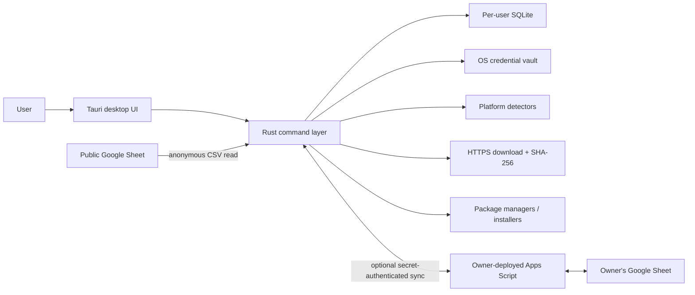

# Installor Architecture

## Design goals

Installor is local-first, explicit, auditable, and portable. The design keeps the core workflow useful without an online account, treats process execution as a security boundary, and separates anonymous Sheet import from optional authenticated write-back.

## System context

## Components

<table width="100%">
  <tr><th width="26%" align="left">Component</th><th width="37%" align="left">Responsibility</th><th width="37%" align="left">Boundary</th></tr>
  <tr><td><code>src/</code></td><td>Views, forms, selection, progress, confirmation, and tested pure UI helpers.</td><td>No direct database or process access; calls registered Tauri commands.</td></tr>
  <tr><td><code>src-tauri/src/db/</code></td><td>Schema, catalog/install records, settings, and pending sync operations.</td><td>Secrets are excluded and delegated to the credential vault.</td></tr>
  <tr><td><code>src-tauri/src/detect/</code></td><td>Platform-native installed-software enumeration and parsing.</td><td>Results are suggestions and require user action.</td></tr>
  <tr><td><code>src-tauri/src/sync/</code></td><td>Public CSV import, optional Apps Script client, merge, and retry.</td><td>Public mode is read-only; bridge mode requires owner deployment and secret.</td></tr>
  <tr><td><code>src-tauri/src/installer/</code></td><td>File download, checksum, plan construction, execution, and fuzzy file suggestions.</td><td>Structured argv; sequential execution; user confirmation.</td></tr>
</table>

## Data model

- `catalog`: portable software identity, source, installer, checksum, tags, and timestamps.
- `installations`: machine-specific status, versions, paths, and verification time.
- `sync_queue`: durable local operations awaiting optional remote write-back.
- `settings`: non-secret preferences and endpoint URL.
- OS credential vault: Apps Script shared secret under service `com.installor.desktop`.

SQLite schema creation is idempotent. The local database is the immediate application state; optional remote data is reconciled explicitly.

## Trust model

<table width="100%">
  <tr><th width="25%" align="left">Input</th><th width="35%" align="left">What Installor validates</th><th width="40%" align="left">What remains the user's responsibility</th></tr>
  <tr><td>Public Sheet</td><td>Google URL shape, spreadsheet ID, CSV response, required header, supported field parsing.</td><td>Publisher, source IDs, URLs, arguments, checksums, sharing/privacy decision.</td></tr>
  <tr><td>Installer download</td><td>HTTP status, streaming write, optional expected SHA-256.</td><td>Publisher identity, signature, licensing, fitness, and expected checksum provenance.</td></tr>
  <tr><td>Detected software</td><td>Platform parsing and noise filters.</td><td>Whether the record represents software worth cataloging.</td></tr>
  <tr><td>Local file suggestion</td><td>Extension allowlist and name-similarity threshold.</td><td>File provenance and explicit link confirmation.</td></tr>
  <tr><td>Process execution</td><td>Known plan mapping, structured arguments, sequential invocation, captured outcome.</td><td>Elevation, third-party installer behavior, post-install validation.</td></tr>
</table>

## Reconciliation

During optional sync, remote rows are pulled first. For matching IDs, a strictly newer `updated_at` value wins; ties remain local. Pending local operations are pushed after merge. Failed pushes stay in `sync_queue` and retry on the next successful sync. There is no background polling service in v0.1.0.

## Verification strategy

- Rust unit/integration tests cover SQLite round trips, parsers, plan arguments, download/checksum behavior, file ranking, process execution, and merge/retry.
- Vitest/jsdom tests cover selection, validation, search, and status rendering.
- GitHub Actions executes formatting, strict linting, frontend tests, and Rust tests on Windows, macOS, and Ubuntu.
- Tagged builds create native packages; real-hardware and signing status are documented separately from automated evidence.

## Extension points

New package managers should extend `SourceType`, detection/parsing, plan construction, serialization contracts, UI choices, templates, and tests together. New credentialed integrations must preserve a no-account local path, document the data boundary, and use an appropriate secure credential store.
